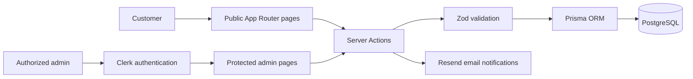

<div align="center">
  

  <h1>Red Diamond Cigars</h1>

  <p>A full-stack product catalog and inquiry-management platform for a boutique cigar business.</p>

  <p>
    <a href="https://www.reddiamondcigar.com">Live Site</a>
    ·
    <a href="#features">Features</a>
    ·
    <a href="#local-development">Local Development</a>
  </p>
</div>

## Overview

Red Diamond Cigars gives customers a polished way to browse available cigars, review product details, and submit purchase inquiries. Behind the public site is a protected admin workspace for managing inventory and following each inquiry from initial contact through completion.

The application intentionally uses an inquiry workflow instead of online checkout. This keeps payment processing outside the application while still giving the business a structured sales pipeline.

## Features

### Customer experience

- Responsive landing page, product catalog, product-detail pages, brand story, and contact page
- Inventory-aware product information and product-specific inquiry forms
- Form validation with React Hook Form and Zod
- Required age and inquiry-only confirmations before submission
- Inquiry records stored in PostgreSQL
- Transactional email notifications for the business and customer
- Persistent age-gate acknowledgement in the browser

### Admin workspace

- Clerk authentication plus an email allowlist for protected admin routes
- Dashboard metrics for products, inquiries, and inventory status
- Product creation, editing, archiving, and restoration
- Inquiry search, filtering, status updates, notes, archiving, and restoration
- Low-stock and out-of-stock visibility

## Tech Stack

| Area | Technology |
| --- | --- |
| Framework | Next.js 16 App Router, React 19, TypeScript |
| Styling | Tailwind CSS 4, shadcn/ui, Radix UI, Motion |
| Database | PostgreSQL, Prisma ORM, `@prisma/adapter-pg` |
| Authentication | Clerk |
| Forms and validation | React Hook Form, Zod |
| Email | Resend |
| Deployment | Vercel |

## Architecture



The main records are `Product` and `Inquiry`. A product holds catalog and inventory data; an inquiry stores customer details, requested quantity, pipeline status, and private admin notes.

## Local Development

### Prerequisites

- Node.js 20.9 or newer
- npm
- A PostgreSQL database
- Clerk and Resend accounts

### 1. Clone and install

```bash
git clone https://github.com/JhonEncarnacion/red-diamond-cigars.git
cd red-diamond-cigars
npm install
```

### 2. Configure environment variables

Copy the example file and replace each placeholder with your own value:

```bash
cp .env.example .env
```

| Variable | Purpose |
| --- | --- |
| `DATABASE_URL` | PostgreSQL connection string used by Prisma |
| `RESEND_API_KEY` | API key used to send inquiry emails |
| `NEXT_PUBLIC_SITE_URL` | Public application URL used in links and metadata |
| `NEXT_PUBLIC_CLERK_PUBLISHABLE_KEY` | Public Clerk application key |
| `CLERK_SECRET_KEY` | Server-side Clerk secret |
| `ADMIN_AUTH_EMAIL` | Clerk account email allowed to access the admin workspace |

Never commit real credentials. The repository ignores local `.env` files while keeping `.env.example` available as a template.

### 3. Prepare the database

```bash
npx prisma generate
npx prisma db push
npx prisma db seed
```

The seed step is optional; it adds three sample products for local development.

### 4. Start the application

```bash
npm run dev
```

Open [http://localhost:3000](http://localhost:3000). The admin workspace is available at `/admin` after signing in with the email configured in `ADMIN_AUTH_EMAIL`.

## Available Scripts

| Command | Description |
| --- | --- |
| `npm run dev` | Start the Next.js development server |
| `npm run lint` | Run ESLint |
| `npm run build` | Generate the Prisma client and create a production build |
| `npm run start` | Run the completed production build |

## Project Structure

```text
app/                 App Router pages and server actions
components/          Public, admin, and shared UI components
lib/                 Authentication, database, email, and utility modules
prisma/              Database schema and development seed
public/              Static images and video
proxy.ts             Clerk route protection for the admin workspace
```

## Deployment Notes

The live application is deployed on Vercel. A production deployment requires the same environment variables listed above, a reachable PostgreSQL database, and a verified Resend sender/domain for reliable email delivery.

## Author

Built by [Jhon Encarnacion](https://www.jhonencarnacion.com). Connect on [LinkedIn](https://www.linkedin.com/in/jhonencarnacion/) or view more work on [GitHub](https://github.com/JhonEncarnacion).
