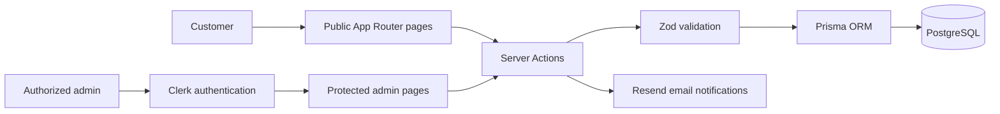

<div align="center">
  

  <h1>Red Diamond Cigars</h1>

  <p>A full-stack product catalog and inquiry-management platform for a boutique cigar business.</p>

  <p>
    <a href="https://www.reddiamondcigar.com">Live Site</a>
    ·
    <a href="#features">Features</a>
    ·
    <a href="#local-development">Local Development</a>
  </p>
</div>

## Overview

Red Diamond Cigars gives customers a polished way to browse available cigars, review product details, and submit purchase inquiries. Behind the public site is a protected admin workspace for managing the catalog and following each inquiry from initial contact through completion.

The application intentionally uses an inquiry workflow instead of online checkout. This keeps payment processing outside the application while still giving the business a structured sales pipeline.

## Features

### Customer experience

- Responsive landing page, product catalog, product-detail pages, brand story, and contact page
- Product specifications and product-specific inquiry forms
- Form validation with React Hook Form and Zod
- Required age and inquiry-only confirmations before submission
- Inquiry records stored in PostgreSQL
- Transactional email notifications for the business and customer
- Persistent age-gate acknowledgement in the browser

### Admin workspace

- Clerk authentication plus an email allowlist for protected admin routes
- Dashboard metrics for inquiries and customer interest
- Product creation, editing, archiving, and restoration
- Inquiry search, filtering, status updates, notes, archiving, and restoration

## Tech Stack

| Area | Technology |
| --- | --- |
| Framework | Next.js 16 App Router, React 19, TypeScript |
| Styling | Tailwind CSS 4, shadcn/ui, Radix UI, Motion |
| Database | PostgreSQL, Prisma ORM, `@prisma/adapter-pg` |
| Authentication | Clerk |
| Forms and validation | React Hook Form, Zod |
| Email | Resend |
| Deployment | Vercel |

## Architecture



The main records are `Product` and `Inquiry`. A product holds catalog data; an inquiry stores customer details, requested quantity, pipeline status, and private admin notes.

## Local Development

### Prerequisites

- Node.js 20.9 or newer
- npm
- A PostgreSQL database
- Clerk and Resend accounts

### 1. Clone and install

```bash
git clone https://github.com/JhonEncarnacion/red-diamond-cigars.git
cd red-diamond-cigars
npm install
```

### 2. Configure environment variables

Copy the example file and replace each placeholder with your own value:

```bash
cp .env.example .env
```

| Variable | Purpose |
| --- | --- |
| `DATABASE_URL` | PostgreSQL connection string used by Prisma |
| `RESEND_API_KEY` | API key used to send inquiry emails |
| `NEXT_PUBLIC_SITE_URL` | Public application URL used in links and metadata |
| `NEXT_PUBLIC_CLERK_PUBLISHABLE_KEY` | Public Clerk application key |
| `CLERK_SECRET_KEY` | Server-side Clerk secret |
| `ADMIN_AUTH_EMAIL` | Clerk account email allowed to access the admin workspace |

Never commit real credentials. The repository ignores local `.env` files while keeping `.env.example` available as a template.

### 3. Prepare the database

```bash
npx prisma generate
npx prisma db push
npx prisma db seed
```

The seed step is optional; it adds three sample products for local development.

### 4. Start the application

```bash
npm run dev
```

Open [http://localhost:3000](http://localhost:3000). The admin workspace is available at `/admin` after signing in with the email configured in `ADMIN_AUTH_EMAIL`.

## Available Scripts

| Command | Description |
| --- | --- |
| `npm run dev` | Start the Next.js development server |
| `npm run lint` | Run ESLint |
| `npm run build` | Generate the Prisma client and create a production build |
| `npm run start` | Run the completed production build |

## Project Structure

```text
app/                 App Router pages and server actions
components/          Public, admin, and shared UI components
lib/                 Authentication, database, email, and utility modules
prisma/              Database schema and development seed
public/              Static images and video
proxy.ts             Clerk route protection for the admin workspace
```

## Deployment Notes

The live application is deployed on Vercel. A production deployment requires the same environment variables listed above, a reachable PostgreSQL database, and a verified Resend sender/domain for reliable email delivery.

### Inquiry submission limits

Inquiries are limited to 5 per IP address per 15 minutes, 3 per email address
(case-insensitive) per hour, and 50 site-wide per hour. Each accepted inquiry
attempts two emails. Windows start with the first accepted submission, and a
rejected request does not consume other buckets. These limits are fixed windows,
not rolling windows; traffic can burst across a window boundary.

Counters are stored in PostgreSQL and updated atomically, so they apply across
server instances and restarts. IP and email bucket keys are SHA-256 hashes;
expired buckets are cleaned up in bounded batches on accepted submissions.
On Vercel, the server uses the platform's `x-vercel-forwarded-for` header
([Vercel documentation](https://vercel.com/docs/headers/request-headers#x-vercel-forwarded-for)).
Locally or on other hosts, requests share an `unknown` IP bucket. Configure a
trusted proxy before deploying to another host; do not trust arbitrary forwarded
headers supplied by clients. Users sharing a public IP share its limit.

**Existing database rollout:** run `npm run db:setup-rate-limit` against the
intended database **before deploying this code**. This additive, repeatable SQL
creates only the rate-limit table and its index; it does not change products or
inquiries. New installations using `prisma db push` already include the table.
If the rate-limit check fails, the action rejects the inquiry without saving it
or sending emails. No additional service or environment secret is required.

Run `npm run test:rate-limit` for header checks. To also run database integration
tests, set `TEST_DATABASE_URL` to a **disposable PostgreSQL database**; these tests
truncate its `InquiryRateLimit` table. They never use `DATABASE_URL` implicitly.

### Product images

Product image paths must reference an existing PNG, JPG, JPEG, WebP, GIF, or
AVIF file under `public/images`. External URLs and missing files are rejected
when creating or updating products. A blank field uses the product's configured
fallback, or the placeholder when no matching fallback exists. Existing invalid
stored paths display the placeholder without changing the stored record.

The available image list in `lib/public-images.json` is generated automatically
by `npm run dev` and `npm run build`. After adding, renaming, or removing images
during development, restart the dev server or run `npm run images:generate`.
Commit the refreshed list with your image changes. Use `npm run test:images`
to check validation, fallbacks, and consistency with the files on disk.

The sample products, seed script, and blank-image fallbacks use the current catalog:

| Product | Image path |
| --- | --- |
| Toro Habano Corojo Red | `/images/products/toro-habano-corojo-red.webp` |
| Toro Habano Ecuador Black | `/images/products/toro-habano-ecuador-black.webp` |
| Maduro San Andres Gold | `/images/products/maduro-san-andres-gold.webp` |

For existing products with these slugs, the seed script updates only their names
and image paths, preserving descriptions and inquiry relationships.

## Author

Built by [Jhon Encarnacion](https://www.jhonencarnacion.com). Connect on [LinkedIn](https://www.linkedin.com/in/jhonencarnacion/) or view more work on [GitHub](https://github.com/JhonEncarnacion).

### Retiring stock tracking

Deploy the updated application and regenerated Prisma client first. The new code works with the old unused column still present. Once all running deployments use the new schema, run `npm run db:remove-stock` against the intended database. This permanently removes only the old `Product.stock` column and its saved counts; products and inquiries remain intact. Do not run this cleanup while an older deployment still reads that column. New databases created from the schema do not include it.

New product slugs are generated from the name. A duplicate generated address is rejected with a message to choose a different name. Slugs are hidden in the editor; editing a name preserves the existing page address. Slugs supplied in update requests are ignored. Enter sizes as `Toro – 6x56` (length first); legacy description dimensions such as `56×6` are formatted automatically. Run `npm run test:catalog` for these rules.

### Independent product and inquiry deletion

Run `npm run db:preserve-inquiries` against the intended database **before deploying this version**. The transactional script backfills saved product details for existing inquiries, makes the catalog link optional, and replaces cascading deletion with `ON DELETE SET NULL`. It is safe to repeat and does not delete products, inquiries, messages, or notes. During rollout, do not delete products until all running deployments use this version, because older admin pages assume the product always exists.

New inquiries save the product name, description, strength, size, wrapper, and original ID. Product deletion preserves those snapshots and detaches the catalog link without changing inquiry timestamps. Admin search, detail views, and dashboard statistics continue to include inquiries for deleted products. Image files are retained because they may be shared.

Admins may separately delete an inquiry from the list or detail page after confirmation. That permanently deletes only that inquiry and its notes; the product and other inquiries remain intact.

### Collection packaging

Run `npm run db:add-packaging` before starting or deploying this version, then regenerate the client with `npx prisma generate`. This repeatable, additive update gives existing and new products placeholder values: Single 10, 5-Pack 45, and Box of 20 160. Admins can change all five numbers in the product editor under Collection packaging. Values display as plain numbers without an assumed currency. Pack and box quantities must be positive whole numbers; displayed values must be nonnegative.

### Languages

The public site supports English, Spanish, French, Portuguese, German, Italian, and Simplified Chinese, in that order in the language menu. The server selects the best supported language from `Accept-Language` on the first visit; English is the fallback. Regional variants such as es-MX and fr-CA use their base language. Traditional Chinese is not treated as a Simplified Chinese translation. A manual choice is saved in a one-year, HTTP-only, SameSite=Lax cookie. “Use browser language” clears that preference. The selector appears in the navigation menu and age gate.

Existing URLs stay unchanged: language selection is cookie-based, with server-rendered text and a matching document language. This does not yet provide separately indexable language URLs or hreflang alternatives. Admin controls remain in English.

Translations live in `messages/{locale}.json`; `messages/source-keys.json` maps source phrases to stable message keys. Keep every catalog complete when changing copy. Currency formatting uses USD, preserving the catalog’s dollar pricing; this is formatting, not currency conversion. The public pages, inquiry validation, feedback, metadata, age gate, and customer email are localized. Customer-entered messages are not translated.

Run `npm run db:add-translations` before deployment, then `npx prisma generate`. This additive, repeatable migration adds a Product JSON translation field without changing original data. The admin product editor has per-language fields for description, strength, wrapper, binder, filler, and origin. Blank entries fall back to the original field; names, sizes, and prices remain shared. Current catalog descriptions and standard strength/country terms also have built-in translations. New custom product descriptions need entries in the editor for each language; they are not machine-translated on demand.

Run `npm run test:i18n` for language negotiation, catalog completeness, interpolation, and product fallback validation. Translation copy should receive fluent-speaker review before publishing.
